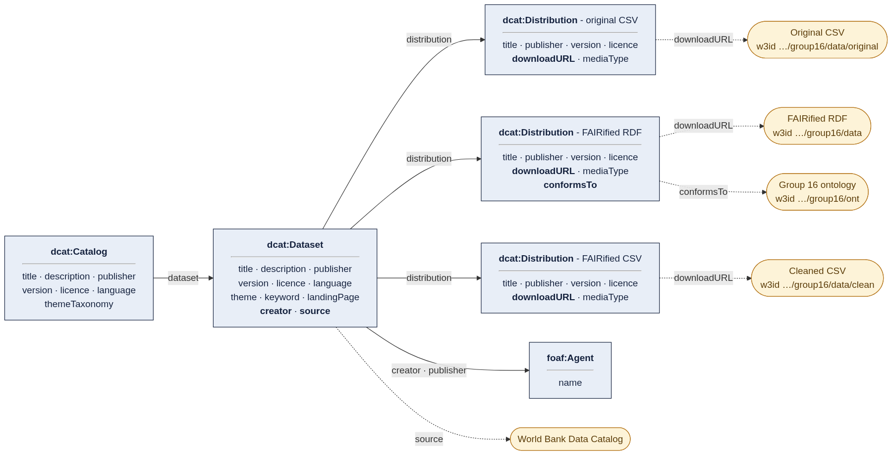
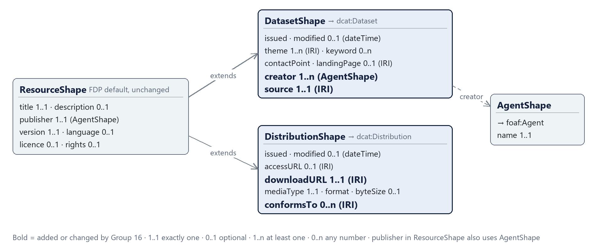

This directory contains the metadata records (FAIR Data Point, catalog, dataset and three distributions; records/fdp.ttl is the FDP itself) and the metadata schemas. dataset-public.ttl is the public copy of the dataset record (PID https://w3id.org/FAIR-course-UT/2026/group16/metadata), because the FAIR Data Point runs locally.

## Semantic metadata model

## SHACL schemas

Bold fields are the ones Group 16 added or changed.

