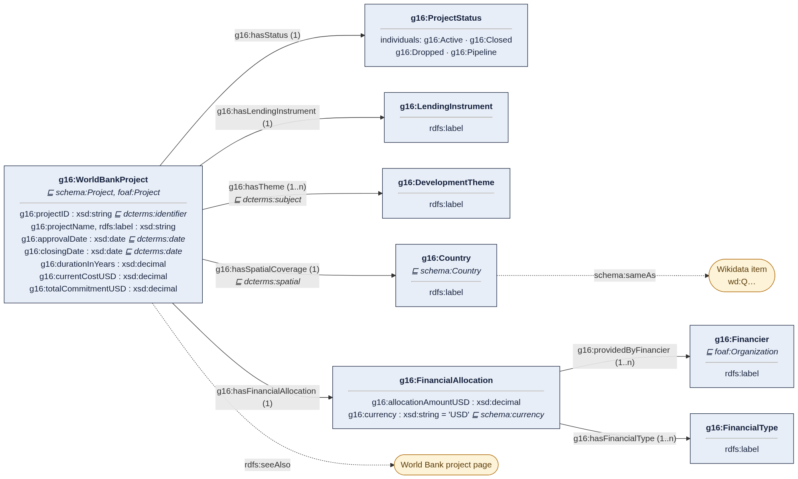
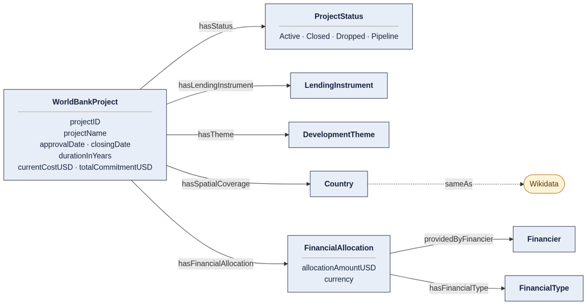

This directory contains the ontology (OWL, in RDF/XML and Turtle).

## Semantic data model

Classes, relations, data properties and cardinalities (g16: = https://w3id.org/FAIR-course-UT/2026/group16/ont#):

Simplified overview:

